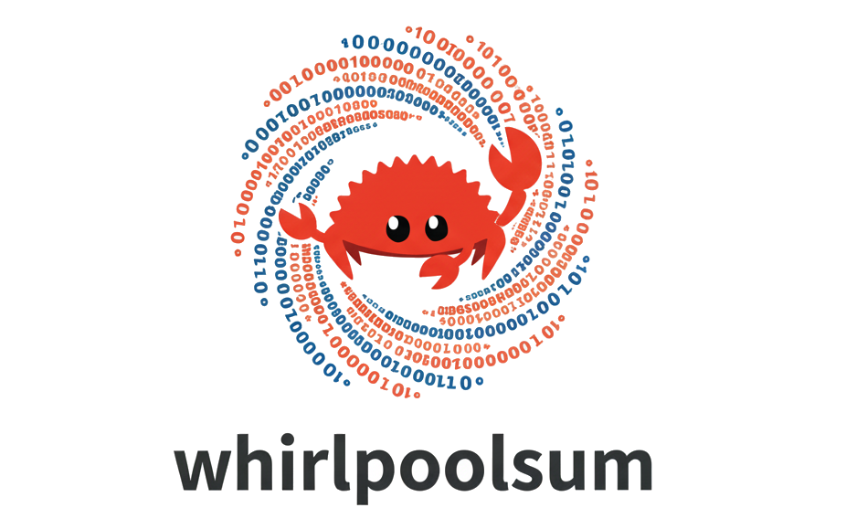

<div align="center">

[](https://rust-lang.org/)
[](http://creativecommons.org/publicdomain/zero/1.0/)



Rust version of the whirlpoolsum that prints and checks WHIRLPOOL 512-bit checksums.

Vibe-coded with Qwen3 (Max+Coder) / Claude Sonnet 4.5 (Thinking+Extended) / Gemini 3 Pro (High).

Integrates [Seccomp/BPF](https://en.wikipedia.org/wiki/Seccomp) sandboxing, [Landlock](https://landlock.io/) and [AppArmor](https://apparmor.net/) profile as a measure of protection against supply chain attacks.

</div>

## Quick install (x86_64/glibc)

```bash
wget https://github.com/c0m4r/rust-whirlpoolsum/releases/download/0.9.4/whirlpoolsum
echo "b1a42fd610ced9db7e36cc0d7d040ab76a401f2f3035f8f61e96c1c05765b976  whirlpoolsum" | sha256sum -c || rm -f whirlpoolsum
sudo mv whirlpoolsum /usr/local/bin/
sudo chmod +x /usr/local/bin/whirlpoolsum
echo "7b730da5ef015a17037ff1e745bccf6c13386d8ed0f982940b110bc8e71c126993546d30182dd6652f751a2f8126ad782e2446133e3b9f2ddd53f0dcf49fe568  /usr/local/bin/whirlpoolsum" | whirlpoolsum -c
whirlpoolsum -V
```

On Alpine install [gcompat](https://git.adelielinux.org/adelie/gcompat) with `apk add gcompat`

## Other platforms (ARM64, RISC-V, Windows x64)

Get the latest binaries at https://github.com/c0m4r/rust-whirlpoolsum/releases/tag/0.9.4

## Build from source

1. [Install Rust](https://rust-lang.org/tools/install/)
2. Run `cargo build --release` or use `./build.sh` for extended testing
3. You'll find the binary executable in ./target/release/whirlpoolsum

### Cross-compile

```bash
cargo install cross --git https://github.com/cross-rs/cross
rustc --print=target-list # find target and consult it with the one on cross-rs page
rustup target add aarch64-unknown-linux-gnu
rustup target add riscv64gc-unknown-linux-gnu
rustup target add x86_64-pc-windows-gnu
rustup target add x86_64-unknown-linux-musl
./cross.sh || cross build --target aarch64-unknown-linux-gnu --release
```

## Usage

Text checksum (stdin)

```bash
echo -n "All your base are belong to us" | whirlpoolsum
```

File checksum

```bash
whirlpoolsum example.txt
```

Multiple files checksums (with multithreading)

```bash
whirlpoolsum --max-files 1000 --max-file-size 100M /usr/sbin/*
```

Verify file checksum (stdin)

```bash
echo -n "abcdef12345(...)  example.txt" | whirlpoolsum -c
```

Verify file checksum with a checksum file

```bash
whirlpoolsum -c example.txt.wrl
```

Print program version

```bash
whirlpoolsum --version
```

## Benchmarking

Benchmark (measure time and throughput for a given filename(s))

```bash
whirlpoolsum --benchmark example.txt
```

Benchmark (system test with score)

```bash
whirlpoolsum --benchmark
```

## TUI

Text-based UI with basic functionality using [ratatui](https://ratatui.rs/)

```bash
whirlpoolsum --tui
```

...and a snake game as a bonus :)

## Configuration options

```
--max-file-size <MAX_FILE_SIZE>  Maximum file size (e.g., 1G, 512M) [default: 10G]
--max-files <MAX_FILES>          Maximum number of files to process [default: 10000]
```

## License

Public Domain / CC0 1.0 Universal

## Credits

Logo has been AI generated by Gemini 2.5 Flash Image (Nano Banana)

[Ferris the crab](https://rustacean.net/) by [Karen Rustad Tölva](https://www.aldeka.net/portfolio/items/ferris/)
